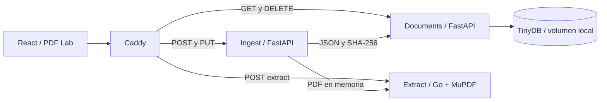

# Arquitectura inicial

## Decisiones

- Separación por responsabilidades: documents no procesa PDF; extract no conoce persistencia; ingest coordina y preserva texto plano.
- Un gateway mantiene mismo origen y oculta rutas internas. El frontend no conoce nombres de contenedores.
- Admisión antes de cargar cuerpos: slots limitados en ingest y extract, tamaños máximos y tiempos de red explícitos.
- TinyDB conserva el alcance de etapa 1: una réplica de documents, sin prometer consistencia distribuida.
- Go/MuPDF es la base de investigación. El rendimiento debe demostrarse con los documentos oficiales, no inferirse del lenguaje.
- Compose de estrés es independiente: sólo Caddy + hasta cinco extract, cada uno con 1 CPU / 512 MiB. El proxy también tiene límites.
- Twelve-Factor: repos separados, dependencias fijadas, configuración por entorno, procesos stateless salvo volumen documental, binding de puertos y logs a stdout.

## Calidad y límites

Markdown inicial por páginas; reconstrucción avanzada de tablas y OCR fuera de alcance.
Pruebas unitarias y smoke HTTP real verifican base; regresiones exhaustivas, investigación y defensa permanecen en el backlog.
No se inventan mediciones, TDD histórico ni aprobación docente. La base permite construir evidencia futura.
